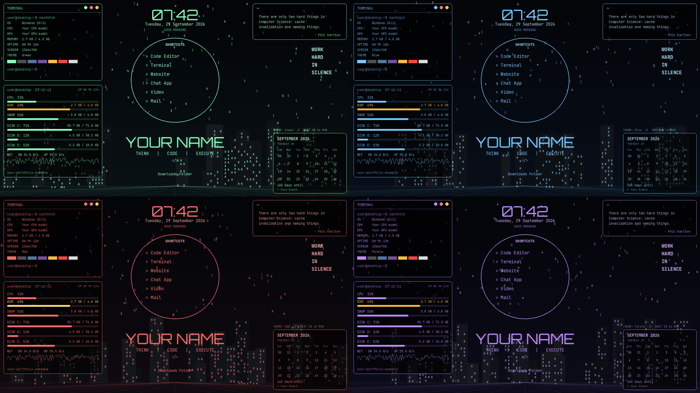

<div align="center">

# HackerVibe Desktop UI

**A cyberpunk Rainmeter desktop suite for Windows — same look, faster engine.**
Clock · Calendar · Weather · System Monitor · Network · Terminal Stats · Quotes · Shortcuts

[](https://www.rainmeter.net)
[](#requirements)
[](LICENSE)
[](Skins/HackerSuite/@Resources/Fonts)


*Green · Blue · Red · Purple — same layout, live-swapped colors and wallpaper.*

</div>

---

## What you get

| Widget | What it shows |
|---|---|
| **Clock** | Time, date, rotating motto / greeting, year progress · click to switch 12h/24h |
| **Calendar** | Full month grid, week number and a countdown to your event |
| **Weather** | Current conditions and tomorrow via [Open-Meteo](https://open-meteo.com) — free, no API key |
| **System Status** | CPU / RAM / swap / disks with color alerts and live graphs |
| **Network** | Live upload/download graph, session totals, ping and local IP |
| **Terminal** | `neofetch`-style OS, CPU, GPU, RAM, uptime, screen and theme readout |
| **Quote** | Rotating quotes from an editable text file (`text|author` per line) |
| **Shortcuts** | One-click editor, terminal, website, downloads folder and more |
| **ThemeCycler** | Cycles Green → Blue → Red → Purple on a timer, wallpaper included |

The visual design is intentionally unchanged from the classic HackerVibe layout.
Version 4 focuses on **setup, reliability and idle CPU** — not a redesign.

## Requirements

- Windows 10 or 11 (64-bit recommended)
- [Rainmeter](https://www.rainmeter.net) 4.4 or newer
  - The installer can install it with `winget` if it is missing
- Internet only for weather (everything else works offline)

## Quick start (3 steps)

```bat
:: 1. get the project
git clone https://github.com/tawsif-frontend-dev/HackerVibe-DesktopUI.git
cd HackerVibe-DesktopUI

:: 2. install (or just double-click install.bat)
install.bat
```

3. Answer a few short questions — name, city, units, theme, your website link
   and the calendar countdown — and press **Y**.

That's it. The widgets load and arrange themselves. No manual copying,
no editing files, no extra downloads.

> Prefer a ZIP? Click **Code → Download ZIP**, extract it, then double-click
> `install.bat` inside the folder.

## What the installer does

1. Finds Rainmeter (and offers to install it with `winget` if missing)
2. Reads your PC profile: user, OS, CPU, GPU, RAM, screen size, skin folder
3. Asks for your name, city, units, theme, website link and calendar event
4. Locates your editor and Downloads folder automatically
5. Backs up the previous `Settings.inc` (keeps the last 3), then copies the skins
   while **keeping your settings, quotes and custom files**
6. Writes your details into `Settings.inc` — never into the skin files
7. Installs the bundled fonts for your Windows user (no admin prompt)
8. Renders four personalized wallpapers and applies the one for your theme
9. Loads all nine widgets and places them in the recommended layout

Useful switches:

| Switch | Effect |
|---|---|
| `-Yes` | No questions; use the provided values |
| `-NoStart` | Copy and configure files but don't load widgets |
| `-NoWallpaper` | Don't change your desktop background |
| `-NoFonts` | Skip per-user font installation |
| `-ResetLayout` | Snap widgets back to the recommended arrangement |
| `-SkinRoot <path>` | Install into a custom Rainmeter skin folder |
| `-SkipDeps` | Never try to install Rainmeter automatically |

Example, fully non-interactive:

```powershell
powershell -ExecutionPolicy Bypass -File .\install.ps1 -Yes `
  -Name "HACKER" -City "Dhaka" -Units metric -Theme Purple `
  -WebsiteLabel "My GitHub" -WebsiteUrl "https://github.com/you"
```

## Personalise it

Everything user-facing lives in one file:
`%USERPROFILE%\Documents\Rainmeter\Skins\HackerSuite\@Resources\Settings.inc`.
Right-click any widget → **Edit settings**, change a value, save, then
right-click → **Refresh all**. The installer keeps your values on update.

| Setting | Default | Meaning |
|---|---|---|
| `UserName` | `Hacker` | Name in the terminal widget and quote credits |
| `ThemeCycleMinutes` | `30` | Minutes between automatic theme changes (`0` = never) |
| `ThemeWallpaper` | `1` | `1` = change wallpaper with the theme |
| `Clock24` | `0` | `0` = 12-hour, `1` = 24-hour |
| `Motto` | `FOCUS / PLAN / EXECUTE / SUCCEED` | Rotating clock line |
| `EventName` / `EventDay` / `EventMonth` | New Year, 1, 1 | Calendar countdown |
| `QuoteMinutes` | `60` | Minutes between quotes |
| `WeatherAuto` | `0` | `1` = detect city by IP (see [Privacy](#privacy)) |
| `Lat` / `Lon` / `LocationName` | London | Fixed weather location |
| `WeatherUnits` | `metric` | `metric` = °C + km/h, `imperial` = °F + mph |
| `WarnAt` / `CritAt` | `60` / `85` | System Status alert thresholds (%) |
| `PingHost` | `1.1.1.1` | Host used by the Network widget |
| `VSCodePath` / `VSCodeLabel` | detected | First shortcut |
| `DownloadsPath` | detected | Downloads shortcut |
| `PortfolioLabel` / `PortfolioURL` | your link | Website shortcut |

Weather units are set by the installer. If you edit them by hand, also set
`WeatherUnitParams`, `TempUnit` and `WindUnit` — or just run `install.bat` again.

## Themes

Right-click any widget → **Theme → Green / Blue / Red / Purple**. Every widget
and the wallpaper switch together.

For automatic rotation, load `ThemeCycler.ini` from Rainmeter → Manage. Set
`ThemeCycleMinutes` to change the interval. Turn off Windows' own wallpaper
slideshow first, or the two will fight over the background.

## Performance

Version 4 keeps the exact same widgets but removes needless work:

- Calendar refreshes **once a minute** instead of every second (a month grid
  does not change faster than that)
- Quotes refresh every 10 seconds and only redraw when the quote rotates
- Theme switching is a single file copy plus one refresh, not a script loop
- Weather polls every 30 minutes through one request
- Nothing runs outside Rainmeter — no tray app, no service, no background daemon

On a 4 GB / Core 2 Duo class machine the suite idles at a few percent CPU.
If you want it even lighter, unload **ThemeCycler** and **Network**; both are
optional.

## Troubleshooting

**A widget is empty or misplaced**

```bat
doctor.bat
```

The doctor checks Rainmeter, all nine widget files, the include files, fonts,
the active theme, wallpaper and the weather API, and prints the exact fix.
You can also run `powershell -ExecutionPolicy Bypass -File .\doctor.ps1`.

**Weather stays blank** — check that `Lat`/`Lon` are set, that you are online,
and that Open-Meteo is reachable (some ISPs/proxies block it). Re-run
`install.bat` and enter your city again to geocode it.

**Fonts look wrong** — the installer installs fonts per user; sign out and back
in if Rainmeter was already open. Manual alternative: right-click each `.ttf`
in `Skins\HackerSuite\@Resources\Fonts` → **Install**.

**Widgets overlap after changing monitor/resolution** — run
`install.bat -ResetLayout` or drag them where you want and save a Rainmeter
layout.

**Installation was interrupted** — run `install.bat` again. Previous settings
are in `@Resources\Settings.inc.backup.<timestamp>` (the last three are kept).

## Update and uninstall

**Update:** pull the latest code and run `install.bat` again. Your settings,
quotes and custom files are preserved.

**Uninstall:**

```powershell
powershell -ExecutionPolicy Bypass -File .\uninstall.ps1
```

This unloads the widgets and deletes the installed `HackerSuite` folder after
confirmation. Use `-KeepFiles` to unload only, or `-Yes` to skip the prompt.
Your wallpaper and the per-user fonts are left alone.

## Manual install

<details>
<summary>Show the manual steps</summary>

1. Install the fonts in `Skins\HackerSuite\@Resources\Fonts` (right-click → Install).
2. Copy the whole `HackerSuite` folder into `Documents\Rainmeter\Skins\`.
3. Open `@Resources\Settings.inc` and fill in your name, weather location and links.
4. Optional: render your name onto the wallpapers — `pip install pillow` then
   `python tools/make_wallpapers.py "YOUR NAME"`, and pick a PNG from
   `@Resources\Wallpaper`.
5. In Rainmeter → Manage → HackerSuite, select the nine `.ini` files and **Load**.
6. Drag each widget into place, then Layouts → **Save layout**.

Full details, including manual theme switching, are in
[`Skins/HackerSuite/README.txt`](Skins/HackerSuite/README.txt).
</details>

## Privacy

- **Weather** sends only the coordinates from `Settings.inc` to Open-Meteo.
  IP-based lookup is **off by default** (`WeatherAuto=0`). If you enable it, your
  public IP is sent to `ip-api.com` over HTTP.
- **Network** pings `PingHost` (`1.1.1.1` by default).
- **No telemetry, no accounts, no personal data in this repository.** Your name,
  paths and city are written only into your local installed copy by the installer.

## Project structure

```
HackerVibe-DesktopUI/
├── install.bat / install.ps1     # one-click installer / personaliser
├── doctor.bat / doctor.ps1       # health check
├── uninstall.ps1                 # clean removal
├── tools/
│   ├── make_wallpapers.py        # renders your name onto the base art
│   └── build_rmskin.py           # builds a .rmskin package
└── Skins/HackerSuite/
    ├── Clock/ Calendar/ Weather/ ...   # one .ini per widget
    └── @Resources/
        ├── Settings.inc           # all user-facing config
        ├── Themes/ + Variables*.inc
        ├── Wallpaper/             # base art + generated wallpapers
        ├── Fonts/                 # bundled, open-licensed fonts
        └── Scripts/               # Lua: theme engine, quote rotator
```

## Linux

The matching Conky suite lives in
[Hacker-Vibe-UI-Desktop-Linux-version-](https://github.com/tawsif-frontend-dev/Hacker-Vibe-UI-Desktop-Linux-version-).
Both projects share the same themes, wallpaper art and layout ideas, and both
have a one-command installer. See that repository's README for Linux setup.

## Contributing

Issues and pull requests are welcome — new themes, widgets or bug fixes.
Please keep new configuration generic (no hard-coded personal paths or names);
route user-specific values through `Settings.inc` so the installer can fill them.

## License

Project code is [MIT](LICENSE). JetBrains Mono and Orbitron are bundled under
the SIL Open Font License; license texts are in
`Skins/HackerSuite/@Resources/Fonts/`. The legacy Open Sans Light and Roboto
files are distributed under Apache-2.0 with their notices in the same folder.

---
<div align="center">
If this saved you some setup time, a ⭐ on the repo helps others find it.
</div>
